# Code Scope

**English** | [Português](README.pt-br.md)

A VS Code extension that shows your code running, visually, for people learning to program. Free and open source ([MIT](LICENSE)).

> **Beta.** Version 0.7.0 is a beta for people to try and help shape. Install it from the [release page](https://github.com/celoramos/Code-Scope/releases/tag/v0.7.0), and if something looks wrong or confusing, [open an issue](https://github.com/celoramos/Code-Scope/issues/new/choose): that is the most useful help right now.

Everything happens inside VS Code: the panel sits in the sidebar, next to your code, and uses your theme's colors. It opens no browser, needs no account and sends nothing to the internet.

While you debug, a side panel draws your program: arrays, matrices, lists, stacks, queues, dictionaries, objects, linked lists, trees and the call stack. Think of it as someone drawing your program on a whiteboard. It works with Java, JavaScript, TypeScript, Python, C# and C, and with any other language that has a debugger in VS Code (see [Languages](#languages)). On every F10 the panel animates what changed and explains what happened:

- the changed box flashes and stays highlighted;
- a swap shows the two boxes crossing over, even when the code uses a `temp` variable and takes two steps;
- `i`, `j`, `inicio` and `fim` become colored arrows that slide under the boxes;
- in a list, a new item appears and the ones after it make room; an item that leaves goes away and its neighbors close the gap;
- in a stack, a pushed item drops onto the top of the tower and a popped one rises and fades, with the "top" label following along;
- in a queue, items enter from the right of the conveyor belt and the one in front leaves on the left;
- in a matrix, the row and column the code reads are highlighted and the cell where they cross gets an outline;
- the text says what changed and which path the program took: "numeros[0] and numeros[1] swapped places", "the condition on line 8 was false: the program skipped the if block", "end of one loop iteration";
- before an `if` or a loop runs, its condition is split into parts, each one marked true or false with the values in place of the names (`ordenado[meio] == alvo (17 == 25)`), respecting short-circuit;
- when a function calls another one, or itself, the call stack shows one card per call, each with its own variables; the call that finishes leaves saying what it returned;
- objects become cards labeled with the variables that point to them: two names on one card are two variables on the same object, not a copy. Linked lists are drawn as nodes and arrows, binary trees as trees;
- dictionaries (`HashMap`, `dict`, JavaScript objects and `Map`) become a key and value table;
- in searches and sorts, the positions being compared get an outline, the part of the array a search has already discarded fades out, and the panel counts comparisons and swaps;
- when the program crashes, the panel stops at the error and explains it in plain words; an index out of range shows the position that does not exist, dashed, next to the array;
- a trace table fills in step by step, one row per step and one column per variable, like the desk check done on paper;
- a variable that leaves scope stays one step, crossed out, and a block variable that hides another one with the same name is marked;
- when recursion splits in two, like `fib(n - 1) + fib(n - 2)`, a recursion tree shows every call, the value each one returned and how many times the same work was redone;
- a list of objects shows each object inside its position (`turma[1]` with its name and grade); a dictionary of lists becomes a graph, with the visited nodes, the current one and the queue of a breadth-first search;
- inside a `catch`, the panel explains which line raised the error and that the rest of the `try` did not run; when a subclass method runs, it says why it was that version (polymorphism);
- text read letter by letter becomes a row of letters with the index arrow, and the classic number traps are explained when they happen: integer division, `0.1 + 0.2`, overflow.
- `==` versus `equals` (and `is` versus `==` in Python): when a condition compares two objects, the text says whether it asked "same object?" or "same contents?", and explains the classic traps, like `==` between two equal Java strings, or `equals` in a class that never wrote one.
- changing in place or creating a new one: `x.sort()` changes the list itself (and every name for it), `sorted(x)`, `slice()` or `Arrays.copyOf` make a new one, and `s.trim();` alone on a line creates a text nobody keeps, so `s` stays the same.
- how much it costs: under the comparison counter, a table puts the program's count next to log n, n, n log n and n², for its own size and for 1000 positions, where a loop inside a loop already makes a million comparisons.

Three extra tools:

- **Guess first**: before a line runs, the panel asks what the variable will be. After F10 it says if the guess was right and keeps the score.
- **Presentation mode**: the panel opens large next to the code, with bigger text and slower animations, ready to project or record.
- **Save image**: the current step becomes a PNG, for slides, notes or to share.

The panel speaks English and Portuguese and follows the language of your VS Code: Portuguese when VS Code is in Portuguese, English otherwise.

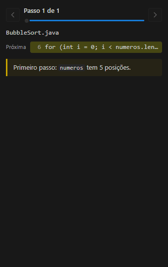

| Stack | Queue |
|---|---|
| 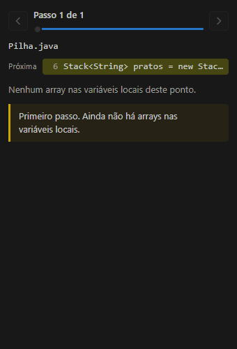 | 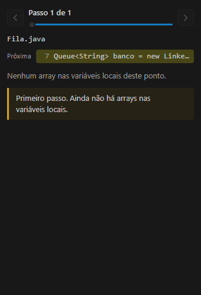 |

| Matrix | List |
|---|---|
| 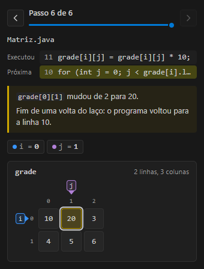 | 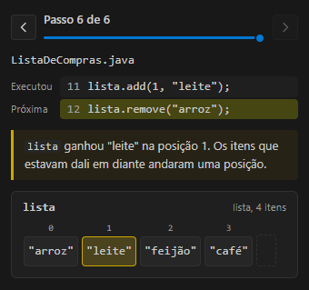 |

| Recursion tree | Error explained |
|---|---|
| 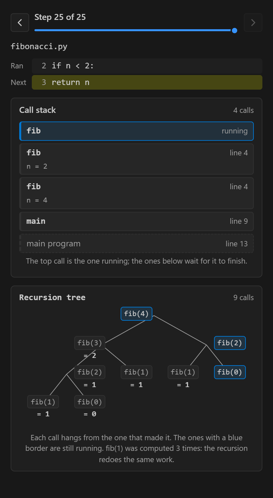 | 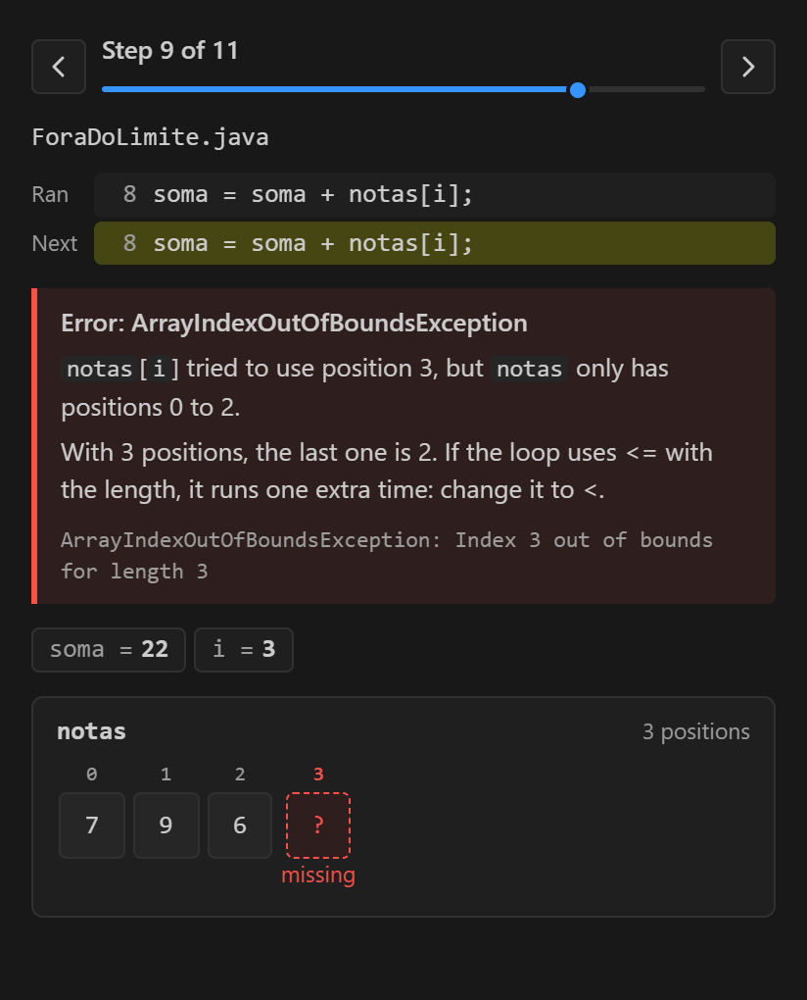 |

| Binary search | Graph |
|---|---|
| 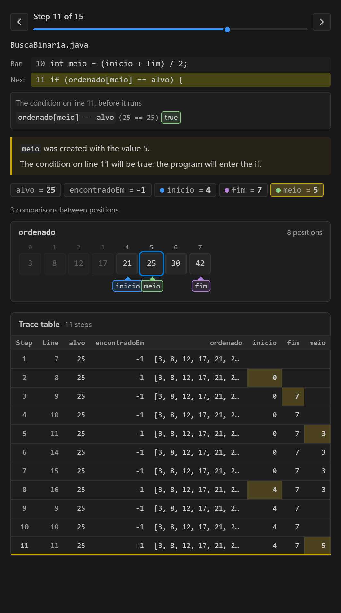 | 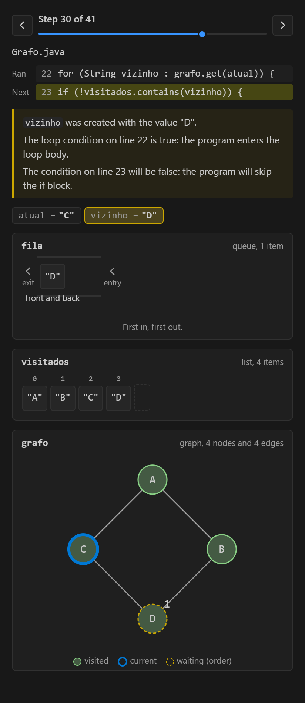 |

| List of objects | Binary tree |
|---|---|
| 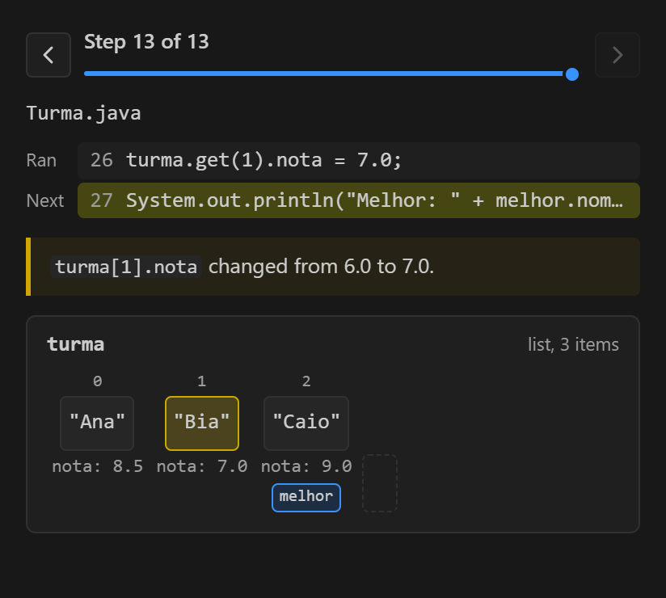 | 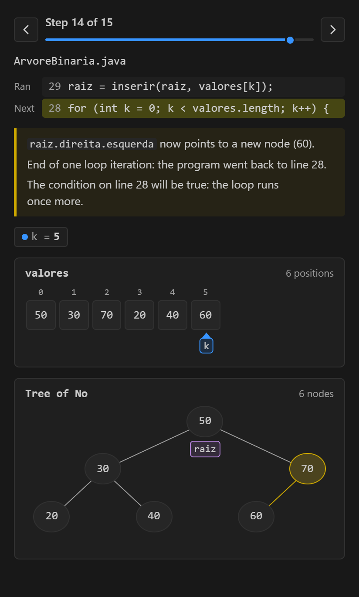 |

*Panel captures made with data from real debugger sessions (Java, JavaScript and Python), saved with the panel's own "Save image" button.*

## Languages

Code Scope talks to the debugger through the **Debug Adapter Protocol**, the protocol VS Code uses with every debugger. Each debugger formats values its own way, so each language has an adapter that translates that text for the panel. Languages without their own adapter use the generic mode.

| Language | Debugger | Structures | Status |
|---|---|---|---|
| Java | Debugger for Java (`vscjava.vscode-java-debug`) | arrays, matrices, `ArrayList`, `Stack`, `Queue`, `ArrayDeque`, `HashMap`, objects, linked lists, trees | validated with the real debugger |
| JavaScript and TypeScript | the one built into VS Code (Node, Chrome, Edge) | arrays, matrices, stack (`push`/`pop`), queue (`push`/`shift`), objects as dictionaries, `Map`, class instances, linked lists, trees | validated with the real debugger on Node; the browser uses the same adapter, not tested yet |
| Python | Python Debugger (`ms-python.debugpy`) | `list`, `tuple`, `deque`, `dict`, matrices, stack (`append`/`pop()`), queue (`pop(0)`/`popleft()`), objects, linked lists, trees | validated with the real debugger |
| C# | C# extension (`ms-dotnettools.csharp`) | arrays, `List`, `Stack`, `Queue`, `Dictionary`, objects, linked lists | validated with the real debugger |
| C | C/C++ extension (`ms-vscode.cpptools`) with gdb | arrays, pointers to `struct`, linked lists | validated with the real debugger (gdb) on Windows and Linux; on macOS the C/C++ extension uses lldb, not tested yet. C++ containers like `std::vector` are not drawn yet |
| Others (Go, Rust, PHP...) | any VS Code debugger | collections the debugger marks as indexed, integers and simple values | generic mode: shows what the protocol guarantees and leaves out what it does not understand |

The flow explanations (if, loops, break) understand the C family (Java, JavaScript, C#, C, Go) and Python. If the panel does not recognize something in your language, open an [issue](https://github.com/celoramos/Code-Scope/issues/new/choose) with the log (see below): that is how a new adapter starts.

## What the panel shows

| Part | What it shows |
|---|---|
| Timeline | "Step 7 of 13", previous and next buttons, and a slider to jump to any step. Reviewing the history does not rewind the program. |
| Code | The line that just ran and the next one, in the same color the editor uses for the stopped line. |
| Explanation | One sentence per change, plus the path the program took (if, loop, break). Can be turned off. |
| Condition | Before an `if`, `while` or `for` runs: each part of the condition with its values and whether it is true or false. Parts that short-circuit skips are greyed out. |
| Error | When the program stops at an error nobody handled: what happened in plain words, a hint of where to look, and the original message below. |
| Call stack | With two functions or more running: one card per call, the current one on top, each with its own variables. |
| Variables | Integers, strings, booleans, characters and decimal numbers. Integers that become arrows take the arrow's color. A variable that just left scope stays one step, crossed out. |
| Structures | Arrays, matrices, lists, stacks and queues. Stacks and queues are recognized by how the code uses the collection. Two names for the same array are drawn once. In searches, compared positions get an outline and discarded ones fade. |
| Dictionaries | Key and value table; a new key slides in, a replaced value flashes. |
| Objects | One card per object of a class you wrote, with the variables that point to it. Linked lists as nodes and arrows, trees as trees. |
| Trace table | One row per step and one column per variable, with the changed cell highlighted. Click a step number to go back to it. |
| Recursion tree | When recursion splits in two: all calls, each hanging from its caller, with what it returned. |
| Graph | A dictionary of lists that point to its own keys, with the visited nodes, the current one and the waiting queue. |
| Guess first | A question before the line runs, the check after F10 and the score. |

## Requirements

- VS Code 1.95 or newer
- The debugger for your language:
  - Java: **Extension Pack for Java** (`code --install-extension vscjava.vscode-java-pack`) and a JDK
  - JavaScript and TypeScript: Node.js 22 or newer; the debugger ships with VS Code. With Node.js 20 the VS Code debugger (js-debug 1.140) runs the program without stopping at breakpoints
  - Python: the **Python** extension (`code --install-extension ms-python.python`), which brings debugpy, and Python installed
  - C#: the **C#** extension (`code --install-extension ms-dotnettools.csharp`) and the .NET SDK
  - C: the **C/C++** extension (`code --install-extension ms-vscode.cpptools`), a compiler and gdb (for example MinGW-w64 or w64devkit on Windows)

## Install

The extension is not on the VS Code Marketplace yet. Download `code-scope.vsix` from the [beta release](https://github.com/celoramos/Code-Scope/releases/tag/v0.7.0) and install it:

```bash
code --install-extension code-scope.vsix
```

Or, in VS Code, open the Extensions view, click the **...** menu and choose **Install from VSIX...**.

To try the latest commit instead, take the `.vsix` from the latest CI run (the repository's **Actions** tab, artifact `code-scope-vsix`) or build your own:

```bash
npm install
npm run vsix
code --install-extension code-scope.vsix
```

## Run from source

```bash
git clone https://github.com/celoramos/Code-Scope.git
cd Code-Scope
npm install
```

Open the folder in VS Code and press **F5**. The "Rodar extensão" configuration builds the project and opens a second window, the *Extension Development Host*, with the Java, JavaScript and Python samples already open (`samples/exemplos.code-workspace`).

While developing, `npm run watch` rebuilds on every change; reload the test window with `Ctrl+R`.

## Trying the samples

In the Extension Development Host window:

1. Open one of the samples and set a breakpoint on the line its comment points to.
2. In the **Run and Debug** tab, pick the configuration and press F5. In Java, each sample has a configuration with the same name; in JavaScript and Python, use "Arquivo aberto". The Code Scope panel opens by itself on the first stop.
3. Step with **F10** (step over) and watch the panel.

| Sample | What to look for |
|---|---|
| `java/BubbleSort.java` | Arrows `i` and `j`; swaps done with `temp` shown as boxes crossing over; true and false ifs |
| `java/BuscaLinear.java` | Linear search: arrow `i` walking the array; `alvo` holds a value, so it does not become an arrow; the break ending the loop |
| `java/InverterArray.java` | Reversing an array: arrows `inicio` and `fim` closing in while the ends swap |
| `java/Palindromo.java` | `char[]` in single quotes; the boolean `ehPalindromo` among the variables |
| `java/Matriz.java` | 2 by 3 grid with row `i` and column `j` highlighted, cell by cell |
| `java/ListaDeCompras.java` | Shopping list: starts empty, items added at the end and in the middle, an item removed from the front |
| `java/Pilha.java` | Stack of plates: `push` on top, `peek` that only looks, `pop` that removes the last one in |
| `java/Fila.java` | Bank line: customers join at the back and are served from the front |
| `java/Parenteses.java` | Classic stack use: checking whether `{[()]}` is balanced by pushing every opening bracket |
| `javascript/bubbleSort.js` | The same BubbleSort in JavaScript, with `let` and `const` inside the loops |
| `javascript/pilha.js` | Undo history: an array used with `push` and `pop` becomes a stack |
| `javascript/fila.js` | Printer queue: an array used with `push` and `shift` becomes a queue |
| `python/bubble_sort.py` | BubbleSort in Python; the swap `a, b = b, a` happens in a single step |
| `python/pilha.py` | Browser back button: `append` and `pop()` on a list |
| `python/fila.py` | Snack bar orders: `deque` with `append` and `popleft()` |
| `Fatorial` (all three languages) | Recursion: use **F11** to enter each call and watch the call stack grow and shrink, each call with its own `n` |
| `ForaDoLimite` / `foraDoLimite` / `fora_do_limite` | A hidden bug: the loop goes one position too far, and the panel stops at the error and shows the position that does not exist |
| `Referencias` / `referencias` | Two variables on the same object (`outra = minha`) and on the same array (`b = a`): changing one changes the other |
| `ListaLigada` / `listaLigada` / `lista_ligada` | A linked list built node by node, and `atual` walking it to the end |
| `ArvoreBinaria` / `arvoreBinaria` / `arvore_binaria` | Values going into a binary search tree, one recursive insertion at a time |
| `Dicionario` / `dicionario` | Counting words in a dictionary: new keys and values being replaced |
| `BuscaBinaria` / `buscaBinaria` / `busca_binaria` | Binary search: the compared position outlined and the discarded half fading out |
| `Escopo` / `escopo` | Variables born and gone with each block; a block `total` hiding the outer one (JavaScript); a parameter with the same name as a field |
| `Fibonacci` / `fibonacci` | The recursion tree: use **F11** and watch `fib(2)` being computed more than once |
| `Turma` / `turma` | A list of students: each object inside its position, and `melhor` pointing to one of them |
| `Grafo` / `grafo` | Breadth-first search on a graph of cities: visited nodes, current node and the queue |
| `Heranca` / `heranca` | Inheritance: with **F11**, see `Cachorro.falar` run instead of `Animal.falar` |
| `TrataErro` / `trataErro` / `trata_erro` | `try/catch`: the line that raised the error and the jump to the `catch` |
| `Texto` / `texto` | A word read letter by letter, and `+` creating a new text |
| `Numeros` / `numeros` | Integer division, `0.1 + 0.2` and int overflow |
| `Igualdade` / `igualdade` | Same object or same contents: `==`, `equals`, `===` and `is` |
| `Copias` / `copias` | Changing in place (`sort`) or creating a new one (`sorted`, `slice`, `trim`) |
| `csharp/` (BubbleSort, Pilha, Fila, Dicionario, ListaLigada) | The same lessons in C#: one project, each sample is a configuration in `launch.json` |
| `c/bubble_sort.c`, `c/lista_ligada.c` | Arrays in C, and a linked list of `struct`s connected by pointers |

With the panel focused: left and right arrows move one step, Home and End jump to the first and last.

If the panel does not show what you expected, open **Output**, pick **Code Scope** and set the level to *Debug*. The channel logs which adapter was used, each snapshot and what the debugger returned.

## Settings

| Setting | Default | What it does |
|---|---|---|
| `codeScope.beginnerMode` | `true` | Shows the sentence explaining each step |
| `codeScope.animationSpeed` | `normal` | Slow, Normal, Fast or Off (in `settings.json`: `slow`, `normal`, `fast`, `off`). If the system asks for reduced motion, animations are off regardless |
| `codeScope.maxElements` | `50` | How many positions of each array, list or matrix row are read |
| `codeScope.valueNames` | `temp`, `aux`, `alvo`, `soma`... | Integers with these names hold a value, not a position, and do not become arrows |
| `codeScope.revealOnDebug` | `true` | Opens the panel on the first stop of each debug session |
| `codeScope.pauseOnErrors` | `true` | Pauses the program on errors nobody handles, so the panel can show where and why it broke. What you checked in the Breakpoints view stays as it is |

Commands in the palette: **Code Scope: Show panel**, **Code Scope: Clear history** and **Code Scope: Presentation mode**.

## How it works

```
language debugger -- "stopped" event --> trackerFactory
                                              |
       stackTrace, scopes, variables  <------ dapCollector (customRequest)
                                              |  the language adapter translates
                                              |  "int[5]@10", "(5) [5, 1, 4]", "[5, 1, 4]"...
                                              v
                   Snapshot { line, code, arrays, pointers, scalars }
                                              |
        History --> diff + explain + flow + arrows --> Frame
                                              | postMessage
                                              v
                             Webview (plain HTML, CSS and JS)
```

| Folder | Responsibility |
|---|---|
| `src/debug` | Speaks the Debug Adapter Protocol. `adapters/` has one adapter per language plus the generic mode; it is the only part that knows each debugger's format. |
| `src/model` | `Snapshot`, step diff, history, arrows, matrix row and column, explanation text. Does not depend on VS Code, DAP or the language. |
| `src/webview` | The panel's `WebviewViewProvider` and the message protocol. |
| `media` | The panel's HTML, CSS and JS. Colors, fonts and borders come from the VS Code theme. |
| `samples` | Samples in Java, JavaScript and Python, with a ready `launch.json`. |
| `test` | Unit tests (mocha) and integration tests with real debuggers. |

## Tests

| Command | What it does |
|---|---|
| `npm test` | Unit tests for the model, adapters and collector, with responses recorded from the real debuggers |
| `npm run test:integration` | Downloads an isolated VS Code into `.vscode-test/`, installs the Java Extension Pack, the Python Debugger and, when the tools are there, the C# and C/C++ extensions in it, and really debugs the Java, JavaScript, Python, C# and C samples. Your VS Code is not touched. Takes a few minutes the first time |

CI runs both on every push, on Windows, Linux and macOS, plus the integration test on the minimum VS Code (1.95), and publishes the `.vsix` as an artifact. Each integration job leaves a note on the run page with how many tests passed or were skipped per debugger.

The Python tests need an interpreter. Point to one with the `CODE_SCOPE_PYTHON` variable or, without installing anything, unzip the *Windows embeddable package* from python.org into `.vscode-test/python` and rename the `python3XX._pth` file that comes with it. Without an interpreter, they are skipped with a warning.

The C# and C tests need the .NET SDK, gcc and gdb on the `PATH`. Without installing anything, they can also live in `.vscode-test/dotnet` (the official `dotnet-install` script with `-InstallDir`) and `.vscode-test/w64devkit` (the w64devkit release unzipped there): the test runner adds both to the `PATH` of the test VS Code. Without them, those tests are skipped.

## Known limits

- Earlier calls on the call stack show only their simple variables, not their arrays or objects. At most 12 calls are read.
- Only objects of classes declared in the file being debugged are drawn, at most 40 per step. Objects inside arrays show only as text.
- JavaScript does not show object identity, so the program itself is asked (`a === b`); across steps, an object keeps its identity by the paths that lead to it. A list rebuilt from scratch in a single step can look like new objects.
- A condition part that calls a method is only evaluated when the method just reads (`len`, `.length`, `.size()`, `.equals`, `.get`...); otherwise it shows "cannot tell beforehand".
- Hidden variables (one name hiding another) are detected in JavaScript blocks and in parameters with the same name as a field. Java and Python have no block scope for local variables.
- In generic mode, only collections the debugger marks as indexed, or whose size is written in the value, show up.
- Matrices with three or more dimensions show the third level as text.
- A list that gains or loses more than one item in a single step shows as resized, without the slide animation.
- Outside matrices, an integer becomes an arrow by its value: any integer that fits the indexes points to a box, unless its name is in `codeScope.valueNames`.
- Stacks and queues are recognized by variable name, reading the whole file: the methods used (`push`, `poll`, `popleft`...) are added up from every place. Two variables with the same name used in different ways in the same file can be classified wrong.
- If you use F5 (continue) between breakpoints instead of F10, the panel shows the accumulated difference between the two stops, and the "ran" line is the previous breakpoint's.

## Roadmap

1. C++ containers (`std::vector`, `std::map`) and the newer concepts in C#
2. Variables of earlier calls with their arrays and objects, not only simple values
3. `HashSet` and Python `set`
4. JavaScript in the browser, tested with the real debugger
5. Adapter for Go

## Contributing

Code Scope is open source to help as many people as possible get into programming, and to help those already in it understand their own code better. You can help even if you are just starting:

- report what confused you in the panel by opening an [issue](https://github.com/celoramos/Code-Scope/issues/new/choose);
- write a new sample in `samples/`, in any language;
- improve an explanation sentence;
- write the adapter for your favorite language;
- implement a roadmap item.

The [good first issues](docs/good-first-issues.md) list says what to do, where to look and how to know you are done, from tasks that need no code to new language adapters. The [contributing guide](CONTRIBUTING.md) explains how to set up the environment, run the tests and where each part of the code lives. All participation follows the [code of conduct](CODE_OF_CONDUCT.md).

## License

[MIT](LICENSE). You may use, study, modify and distribute it, including in classes and courses.
