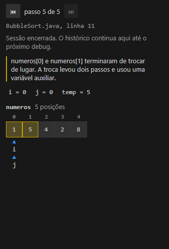

# Code Scope

Extensão do VS Code que mostra o código rodando de forma visual, para quem está aprendendo a programar.

Neste MVP ela desenha os **arrays Java** durante o debug. Quando o programa para num breakpoint ou avança com um step, o painel lateral mostra cada array como uma fileira de caixas com índice e valor. As variáveis `int` que servem de índice, como `i`, `j` ou `min`, aparecem como setas embaixo das caixas.

A cada passo o painel anima o que mudou e explica em uma frase:

- a caixa alterada pisca e fica marcada;
- uma troca aparece como as duas caixas se cruzando;
- a seta de `i` desliza quando `i++` acontece;
- o texto diz, por exemplo, "numeros[2] mudou de 5 para 3" ou "numeros[0] e numeros[1] trocaram de lugar".



*Prévia renderizada fora do VS Code, com dados simulados de um passo do BubbleSort.*

<!-- TODO: trocar por um GIF gravado no Extension Development Host rodando samples/java/BubbleSort.java -->

## Requisitos

- VS Code 1.90 ou mais novo
- Node.js 20 ou mais novo
- Um JDK instalado (os exemplos foram compilados com o JDK 21)
- Extensão **Debugger for Java** (`vscjava.vscode-java-debug`). A forma mais simples é instalar o **Extension Pack for Java** (`vscjava.vscode-java-pack`), que já traz o debugger e o suporte à linguagem.

```bash
code --install-extension vscjava.vscode-java-pack
```

## Como rodar

```bash
git clone https://github.com/celoramos/Code-Scope.git
cd Code-Scope
npm install
```

Abra a pasta no VS Code e aperte **F5**. A configuração "Rodar extensão" compila o projeto e abre uma segunda janela, o *Extension Development Host*, com a extensão carregada e a pasta `samples/java` aberta.

Para recompilar a cada alteração durante o desenvolvimento, rode `npm run watch` e recarregue a janela de teste com `Ctrl+R`.

## Testando com os exemplos

Na janela do Extension Development Host:

1. Clique no ícone do **Code Scope** na Activity Bar. É o ícone de três caixas com uma seta.
2. Abra `BubbleSort.java` e coloque um breakpoint na linha do primeiro `for`.
3. Abra a aba **Run and Debug**, escolha **BubbleSort** e aperte F5.
4. Quando parar, use **F10** (step over) e acompanhe o painel.

| Exemplo | O que observar |
|---|---|
| `BubbleSort.java` | Setas `i` e `j` andando; trocas feitas com `temp` aparecendo como caixas que se cruzam |
| `BuscaLinear.java` | A seta `i` percorrendo o array até achar o valor; `alvo` não vira seta, porque guarda um valor e não uma posição |
| `InverterArray.java` | As setas `inicio` e `fim` se aproximando enquanto as pontas trocam de lugar |

Use **⏮** e **⏭**, ou as setas do teclado com o painel em foco, para rever passos anteriores. Isso só navega pelo que já foi visto: a execução do programa não volta. O histórico continua disponível depois que o debug termina e é limpo quando uma nova sessão começa.

Se o painel não mostrar o que você esperava, abra **Output → Code Scope**. Esse canal registra cada snapshot e, no nível *Debug*, o que o adaptador Java devolveu.

## Como funciona

```
Debugger for Java ── evento "stopped" ──► trackerFactory
                                              │
          stackTrace → scopes → variables ◄── dapCollector (customRequest)
                                              │  javaAdapter interpreta "int[5] (id=23)", "[0]"...
                                              ▼
                                         Snapshot { line, file, arrays, pointers }
                                              │
                         History ─► diff + explain + setas ─► Frame
                                              │ postMessage
                                              ▼
                                   Webview (HTML, CSS e JS puros)
```

| Pasta | Responsabilidade |
|---|---|
| `src/debug` | Fala o Debug Adapter Protocol. É a única parte que conhece o formato do adaptador Java. |
| `src/model` | `Snapshot`, diff entre passos, histórico, setas e texto explicativo. Não depende do VS Code nem do DAP. |
| `src/webview` | `WebviewViewProvider` do painel e o protocolo de mensagens. |
| `media` | HTML, CSS e JS do painel. As cores vêm do tema do VS Code. |
| `samples/java` | Programas de exemplo com `launch.json` pronto. |
| `test` | Testes unitários com mocha, sem precisar abrir o VS Code. |

Como o `Snapshot` é neutro, suportar outra linguagem significa escrever outro adaptador em `src/debug`. O diff, o histórico e o painel continuam iguais.

## Limites do MVP

- Lê só as variáveis locais do frame atual.
- Mostra até 50 posições por array e até 20 arrays por passo.
- Matrizes (`int[][]`) aparecem como uma fileira em que cada caixa diz só `int[3]`; o conteúdo das linhas ainda não é aberto.
- Um inteiro vira seta quando é um índice válido e o nome não está na lista de nomes que guardam valor (`temp`, `aux`, `alvo`, `soma`, `n`...). Essa lista fica em `src/model/pointers.ts`.
- Se você usar F5 (continue) entre breakpoints em vez de F10, o painel mostra a diferença acumulada entre as duas paradas.

## Desenvolvimento

| Comando | O que faz |
|---|---|
| `npm run compile` | Checa os tipos e gera `dist/extension.js` com esbuild |
| `npm run watch` | Recompila a cada alteração |
| `npm test` | Roda os testes unitários |
| `npm run package` | Build minificado para publicar |

## Roadmap

1. `ArrayList` e `LinkedList`
2. Pilha e fila
3. `HashMap`
4. Recursão, com a pilha de chamadas
5. Stack vs heap, com setas de referência
6. Suporte a JavaScript e Python
