# Code Scope

**English** | [Português](README.pt-br.md)

Code Scope shows your code running, for people learning to program. While you debug, a side panel draws your program and, on every F10, animates what changed and explains it in plain words. Think of it as someone drawing your program on a whiteboard.

It works with Java, JavaScript, TypeScript, Python, C#, C and Go, and in a generic mode with any other language that has a debugger in VS Code. It runs in VS Code, Cursor, Windsurf, VSCodium and Antigravity, and in IntelliJ IDEA and Android Studio (beta, Java only). The panel sits next to your code and uses your theme's colors. It opens no browser, needs no account and sends nothing to the internet. Free and open source ([MIT](LICENSE)).

> **Beta.** Code Scope is on the [VS Code Marketplace](https://marketplace.visualstudio.com/items?itemName=code-scope.code-scope) and is still a beta for people to try and help shape. If something looks wrong or confusing, [open an issue](https://github.com/celoramos/Code-Scope/issues/new/choose): that is the most useful help right now.

<p align="center">
  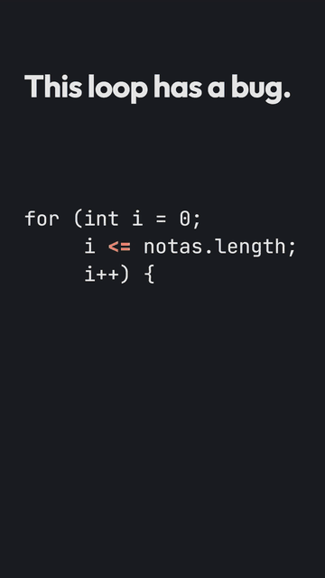
</p>

<p align="center"><a href="docs/video-en.mp4">Watch with sound</a></p>

## What the panel shows

<p align="center">
  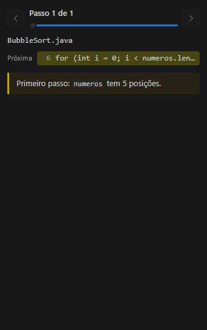
</p>

### Arrays, lists and matrices

An array is a row of boxes. The box that changed flashes and stays highlighted, and a swap shows the two boxes crossing over, even when the code uses a `temp` variable and takes two steps. Variables the code uses as a position, like `i`, `j`, `inicio` and `fim`, become colored arrows that slide under the boxes. `soma = 2` does not point at position 2.

In a list, a new item appears and the ones after it make room; an item that leaves goes away and its neighbors close the gap. In a matrix, the row and column the code reads are highlighted and the cell where they cross gets an outline; a three-dimensional array shows one matrix per layer. In a set (`HashSet`, Python `set`, JavaScript `Set`), boxes have no index, and adding a value that is already there is explained: a set keeps no duplicates.

| Matrix | List |
|:---:|:---:|
| 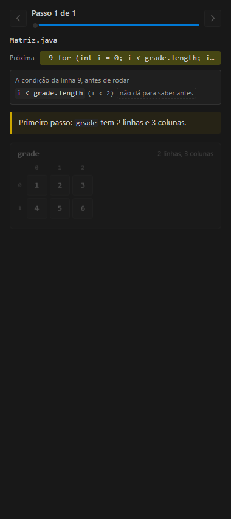 | 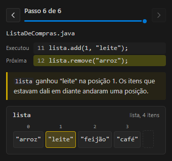 |

### Stacks and queues

The panel recognizes the role of a collection by how the code uses it. A stack is a tower: a pushed item drops onto the top and a popped one rises and fades, with the "top" label following along. A queue is a conveyor belt: items enter from the right and the one in front leaves on the left. A deque (`addFirst` with `pollLast`, `appendleft` with `pop`) enters and leaves at both ends. A priority queue (`PriorityQueue`, `heapq`) shows the array and the same values as a tree, level by level, and the text says who entered and who is at the root now.

| Stack | Queue |
|:---:|:---:|
| 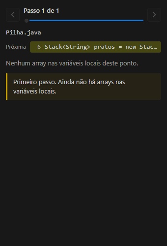 | 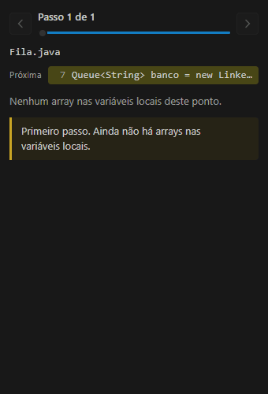 |

### Conditions, searches and errors

Before an `if` or a loop runs, its condition is split into parts. Each part is marked true or false, with the values in place of the names (`ordenado[meio] == alvo (17 == 25)`), and parts that short-circuit skips are greyed out. After the line runs, the text says which path the program took: "the condition on line 8 was false: the program skipped the if block".

In searches and sorts, the positions being compared get an outline, the part of the array a search has already discarded fades out, and the panel counts comparisons and swaps. Under the counter, a table puts the program's count next to log n, n, n log n and n², for its own size and for 1000 positions, where a loop inside a loop already makes a million comparisons.

When the program crashes, the panel stops at the error and explains it in plain words, with a hint of where to look and the original message below. An index out of range shows the position that does not exist, dashed, next to the array. Inside a `catch`, the panel explains which line raised the error and that the rest of the `try` did not run.

| Binary search | Error explained |
|:---:|:---:|
| 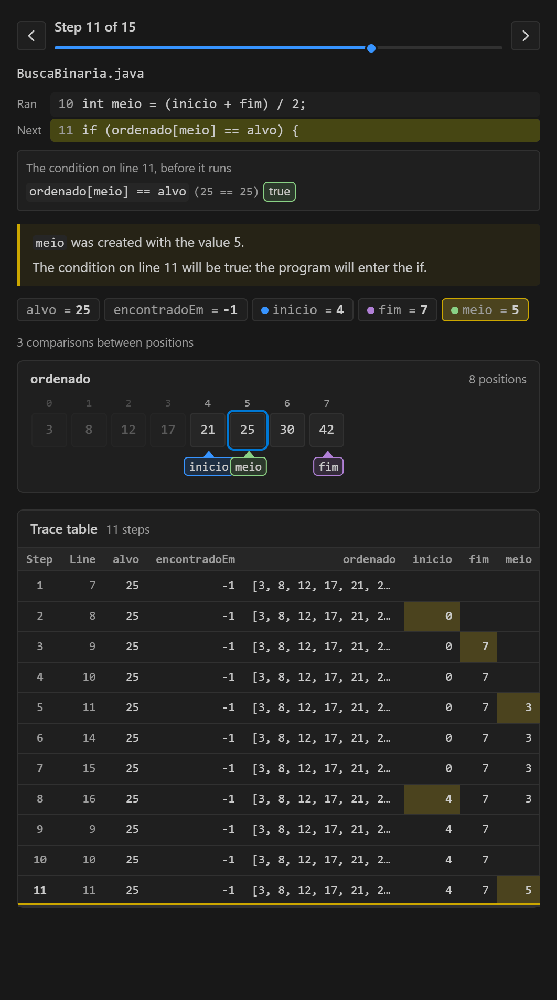 | 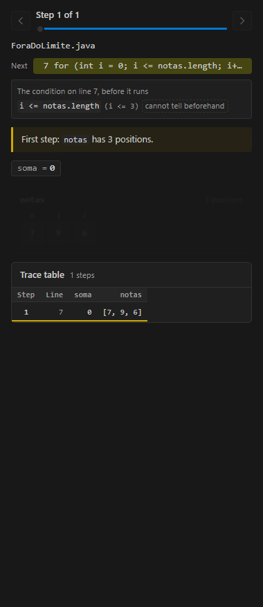 |

### Functions, recursion and objects

When a function calls another one, or itself, the call stack shows one card per call, each with its own variables. The call that finishes leaves saying what it returned. When recursion splits in two, like `fib(n - 1) + fib(n - 2)`, a recursion tree shows every call, the value each one returned and how many times the same work was redone.

Objects of the classes you wrote become cards labeled with the variables that point to them. Two names on one card are two variables on the same object, not a copy. A list of objects shows each object inside its position (`turma[1]` with its name and grade). When a subclass method runs, the panel says why it was that version (polymorphism).

| Recursion tree | List of objects |
|:---:|:---:|
| 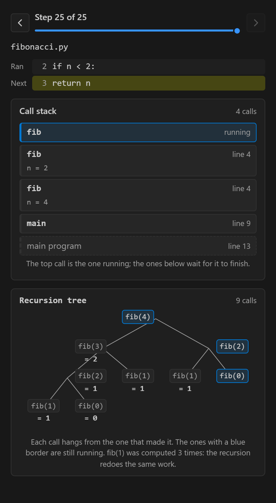 | 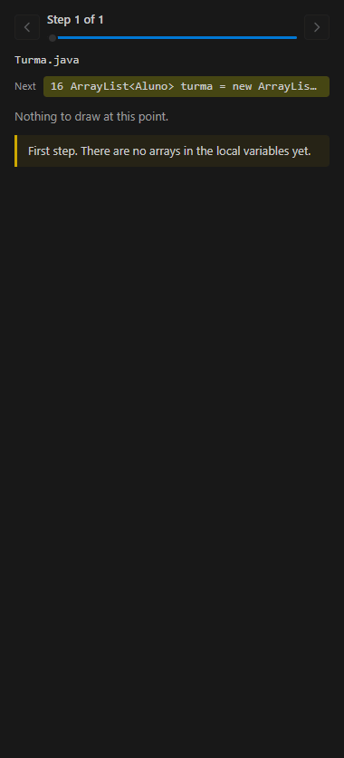 |

### Dictionaries, trees and graphs

Dictionaries (`HashMap`, `dict`, JavaScript objects and `Map`) become a key and value table: a new key slides in and a replaced value flashes. A dictionary of lists that point to its own keys becomes a graph, with the visited nodes, the current one and the queue of a breadth-first search.

Linked lists are drawn as nodes and arrows, binary trees as trees.

| Binary tree | Graph |
|:---:|:---:|
| 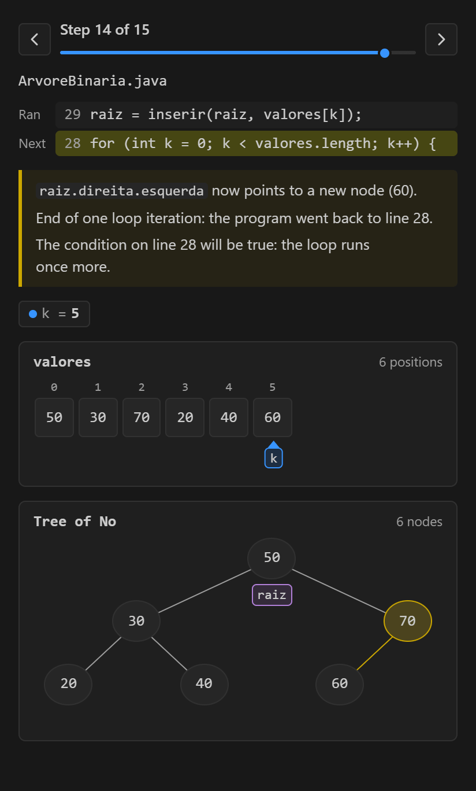 | 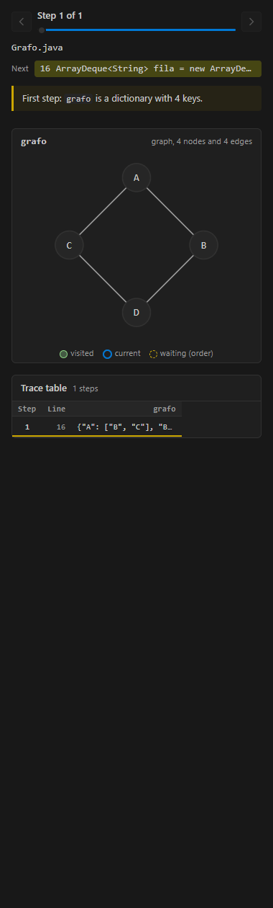 |

### Exercises and teacher notes

Exercises and notes live in comments in the code, so anyone teaching needs only a text editor. They work in every language with `//` or `#` comments.

```java
// @exercise This loop has a bug: the sum should be 15.
// @expect soma = 15
int soma = 0;
// @note Look at how far i goes.
for (int i = 0; i < numeros.length - 1; i++) {
```

The panel shows the goal, checks each `@expect` against the program's real values and says at which step the goal was reached. An `@expect` can name a variable, a position (`numeros[2]`) or a whole array (`numeros = [1, 2, 3]`). A `@note` appears when the program stops on the line below it, or on its own line when it comes after the code. In Portuguese, `@exercicio`, `@espera` and `@nota` work too. The `Exercicio` samples are ready to try.

### Classic traps

The panel explains these when they happen in your program:

- **Numbers:** integer division, `0.1 + 0.2` and overflow.
- **`==` versus `equals`** (and `is` versus `==` in Python): the text says whether the condition asked "same object?" or "same contents?", as in `==` between two equal Java strings, or `equals` in a class that never wrote one.
- **Changing in place or creating a new one:** `x.sort()` changes the list itself, `sorted(x)`, `slice()` or `Arrays.copyOf` make a new one, and `s.trim();` alone on a line creates a text nobody keeps.
- **Scope:** a variable that leaves scope stays one step, crossed out, and a block variable that hides another one with the same name is marked.
- **Text:** a string read letter by letter becomes a row of letters with the index arrow.

### History and extra tools

The timeline shows "Step 7 of 13", with a slider to jump to any step; reviewing the history does not rewind the program. A trace table fills in as you go, one row per step and one column per variable, like the desk check done on paper.

- **Guess first:** before a line runs, the panel asks what the variable will be. After F10 it says if the guess was right and keeps the score.
- **Presentation mode:** the panel opens large next to the code, with bigger text and slower animations, ready to project or record.
- **Save image:** the current step becomes a PNG, for slides, notes or to share.
- **Save GIF:** the whole run becomes an animated GIF, up to 80 steps.
- **Save session:** the run becomes a file anyone can reopen with **Code Scope: Open a saved session**, no debugger needed. The file keeps the source file's name, not its folders.
- **Compare:** this run next to a saved session, with steps, comparisons and swaps. Save a bubble sort, run a quick sort and see the difference.
- **Details:** adds the technical view of each step, like `v[1]: 5 → 3`, under the plain sentences.
- **Find:** type a variable to jump to the steps where it changed, or any text to jump to the lines that contain it.

The panel speaks English and Portuguese and follows the language of your editor.

*Panel captures made with data from real debugger sessions (Java, JavaScript and Python), saved with the panel's own "Save image" button.*

## Languages

Each language has an adapter that translates its debugger's values for the panel. Languages without one use the generic mode, which shows what the Debug Adapter Protocol guarantees and leaves out what it does not understand.

| Language | What you need | Structures | Status |
|---|---|---|---|
| Java | [Extension Pack for Java](https://marketplace.visualstudio.com/items?itemName=vscjava.vscode-java-pack) and a JDK | arrays, matrices, `ArrayList`, `Stack`, `Queue`, `ArrayDeque`, `HashMap`, objects, linked lists, trees | validated with the real debugger |
| JavaScript and TypeScript | Node.js 22 or newer; the debugger ships with VS Code | arrays, matrices, stack, queue, objects as dictionaries, `Map`, class instances, linked lists, trees | validated on Node and in Chrome |
| Python | [Python extension](https://marketplace.visualstudio.com/items?itemName=ms-python.python) and Python | `list`, `tuple`, `deque`, `dict`, matrices, stack, queue, objects, linked lists, trees | validated with the real debugger |
| C# | [C# extension](https://marketplace.visualstudio.com/items?itemName=ms-dotnettools.csharp) and the .NET SDK | arrays, `List`, `Stack`, `Queue`, `Dictionary`, objects, linked lists | validated with the real debugger |
| C and C++ | [C/C++ extension](https://marketplace.visualstudio.com/items?itemName=ms-vscode.cpptools), a compiler and gdb | arrays, pointers to `struct`, linked lists, `std::vector`, `std::string`, `std::map`, `std::set`, `std::stack`, `std::queue` | C validated with gdb on Windows and Linux; lldb on macOS is not tested yet. `std::vector` and `std::string` work with or without pretty-printers; `std::map`, `std::set`, `std::stack` and `std::queue` need them (`-enable-pretty-printing`) |
| Go | [Go extension](https://marketplace.visualstudio.com/items?itemName=golang.go) and Go | arrays, slices, matrices, maps, stack, queue, structs, pointers, linked lists | validated with the real debugger |
| Others (Rust, PHP...) | any VS Code debugger | collections the debugger marks as indexed, integers and simple values | generic mode |

The flow explanations (if, loops, break) understand the C family (Java, JavaScript, C#, C, Go) and Python.

## Install

**VS Code** (1.95 or newer): install from the [Marketplace](https://marketplace.visualstudio.com/items?itemName=code-scope.code-scope), or run:

```bash
code --install-extension code-scope.code-scope
```

**Cursor, Windsurf, VSCodium, Antigravity:** Code Scope is not on Open VSX yet. Download `code-scope.vsix` from the [latest release](https://github.com/celoramos/Code-Scope/releases/latest) and use **Install from VSIX...** in the Extensions view. Java, JavaScript and Python work as in VS Code. Microsoft's C# and C/C++ debuggers do not run in these editors; use the open ones, **C#** by muhammad-sammy (netcoredbg) and **CodeLLDB**, which the tests do not cover yet.

**IntelliJ IDEA 2026.2 or newer, or an Android Studio built on it** (beta, Java only): download `code-scope-jetbrains-*.zip` from the [latest release](https://github.com/celoramos/Code-Scope/releases/latest), then go to **Settings > Plugins > gear icon > Install Plugin from Disk...**. Settings are in **Settings > Tools > Code Scope**.

## Get started

1. Run **Code Scope: Open a sample** from the command palette and pick Java, JavaScript or Python. The **Get started with Code Scope** walkthrough in **Help > Get Started** does the same.
2. Open a sample and press F5. Samples stop by themselves on the first line, and the panel opens. In your own programs, set a breakpoint first: without one, the program runs to the end and there is nothing to draw.
3. Pick the debugger for your language if the editor asks. The ▷ button of extensions like Code Runner only runs the code, without the debugger.
4. Step with F10, or F11 to enter a call, and watch the panel.

In IntelliJ, debug any Java file. The panel opens on the right when the debugger stops; step with F8 or F7.

With the panel focused, the left and right arrows move one step, and Home and End jump to the first and last. Samples cover sorting, searches, recursion, linked lists, trees, graphs, inheritance, `try/catch` and the traps above, each in the folders under [`samples`](samples).

If the panel does not show what you expected, open **Output**, pick **Code Scope** and set the level to *Debug*: the channel logs which adapter was used and what the debugger returned. Then check the [known limits](docs/known-limits.md) or [open an issue](https://github.com/celoramos/Code-Scope/issues/new/choose) with the log.

## How it works in VS Code

Code Scope adds an icon to the Activity Bar, with the panel inside it. It starts when you start debugging and opens the panel on the first stop of each session. You keep using VS Code's own debugger: breakpoints, F5, F10 and F11 work as usual.

On every stop, four things happen:

1. The language's debugger tells VS Code the program stopped, and Code Scope hears it.
2. Code Scope asks that debugger for the call stack, scopes and variables through the Debug Adapter Protocol, the protocol VS Code uses with every debugger.
3. Each debugger writes values its own way (`int[5]@10`, `(5) [5, 1, 4]`, `[5, 1, 4]`), so the language's adapter translates them into a snapshot with the line, the code, the arrays, the pointers and the simple values.
4. Code Scope compares the snapshot with the previous step, works out the arrows and the explanation, and sends the result to the panel, which animates the change.

The panel is a webview in plain HTML, CSS and JS, and its colors, fonts and borders come from your VS Code theme. Steps are saved in a history, so moving through the timeline only redraws what was saved and does not touch the running program. The [contributing guide](CONTRIBUTING.md) shows where each part lives in the code.

## Settings

| Setting | Default | What it does |
|---|---|---|
| `codeScope.beginnerMode` | `true` | Shows the sentence explaining each step |
| `codeScope.animationSpeed` | `normal` | `slow`, `normal`, `fast` or `off`. If the system asks for reduced motion, animations are off regardless |
| `codeScope.maxElements` | `50` | How many positions of each array, list or matrix row are read |
| `codeScope.valueNames` | `temp`, `aux`, `alvo`, `soma`... | Integers with these names hold a value, not a position, and do not become arrows |
| `codeScope.revealOnDebug` | `true` | Opens the panel on the first stop of each debug session |
| `codeScope.pauseOnErrors` | `true` | Pauses the program on errors nobody handles, so the panel can show where and why it broke |

Commands in the palette: **Code Scope: Show panel**, **Code Scope: Clear history**, **Code Scope: Presentation mode**, **Code Scope: Open a sample**, **Code Scope: Open a saved session** and **Code Scope: Compare with a saved session**.

## Roadmap

1. PyCharm and WebStorm: Python and JavaScript in the JetBrains plugin
2. Open VSX
3. The newer concepts in C#

## Contributing

Code Scope is open source to help as many people as possible get into programming, and to help those already in it understand their own code better. You can help even if you are just starting: report what confused you, write a sample, improve an explanation or write the adapter for your favorite language.

The [good first issues](docs/good-first-issues.md) say what to do, where to look and how to know you are done. The [contributing guide](CONTRIBUTING.md) covers setup, tests and where each part of the code lives. All participation follows the [code of conduct](CODE_OF_CONDUCT.md). What changed in each version is in the [changelog](CHANGELOG.md) (in Portuguese).

## License

[MIT](LICENSE). You may use, study, modify and distribute it, including in classes and courses. Created and maintained by [@celoramos](https://github.com/celoramos); everyone who helped is on the [contributors page](https://github.com/celoramos/Code-Scope/graphs/contributors).
