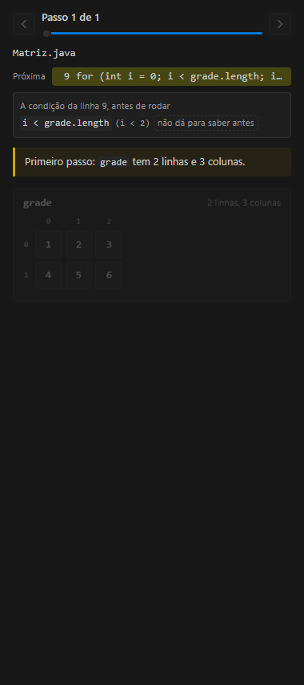
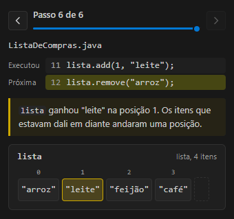
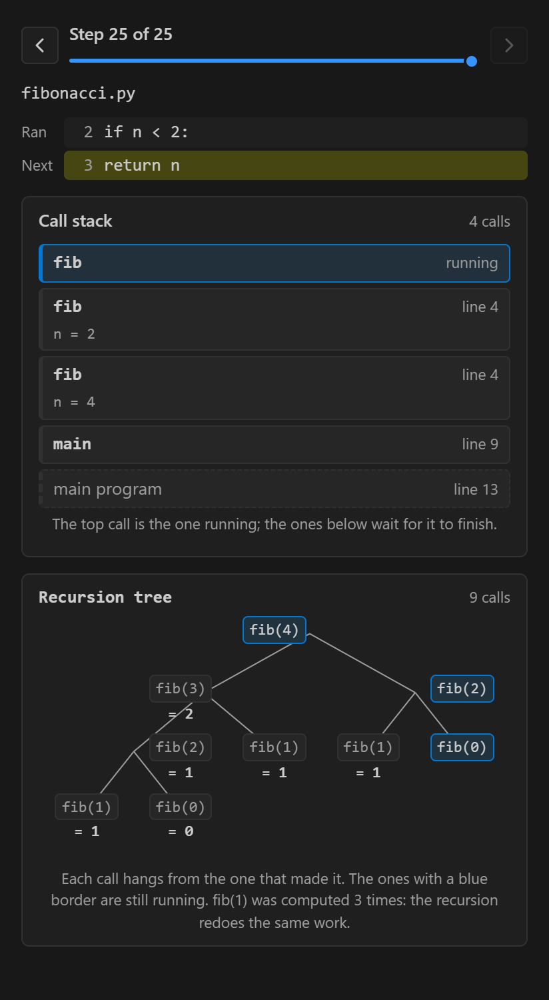
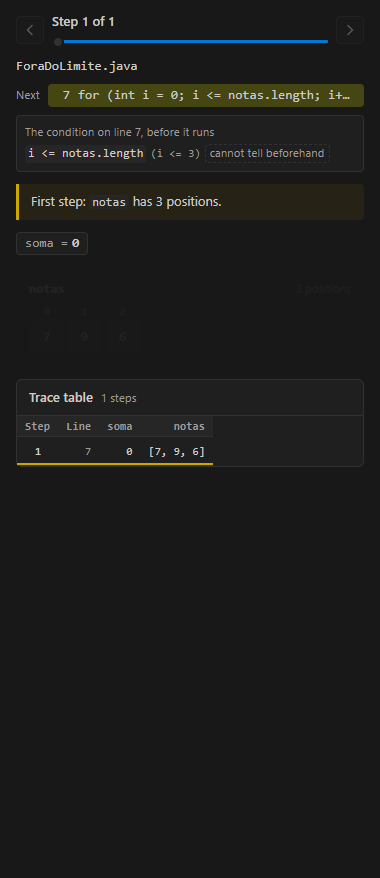
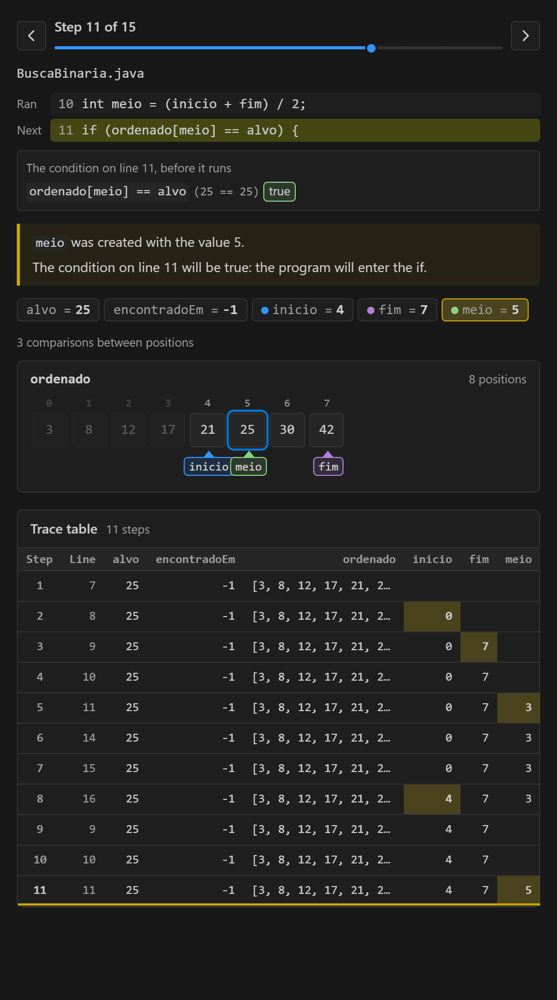
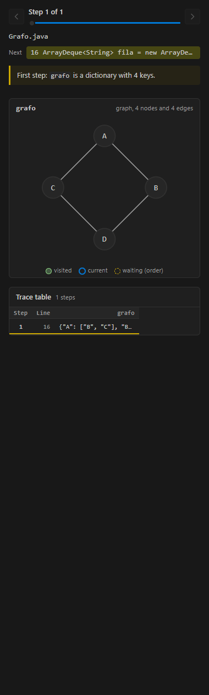
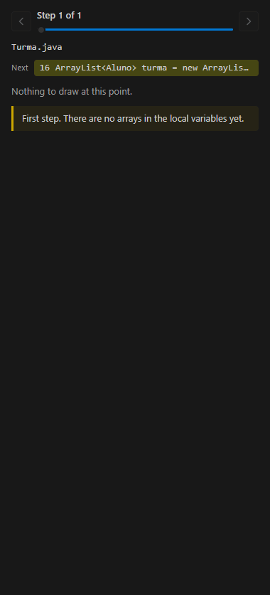
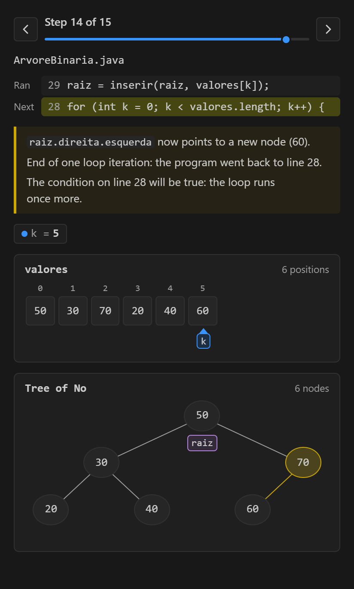

# Code Scope

[English](README.md) | **Português**

Extensão do VS Code, que também roda no Cursor, no Windsurf, no VSCodium e no Antigravity, e plugin para o IntelliJ IDEA (beta, Java), que mostra o código rodando de forma visual, para quem está aprendendo a programar. Gratuita e de código aberto ([MIT](LICENSE)).

> **Beta.** A versão 0.7.0 é uma beta para as pessoas testarem e ajudarem a melhorar. Instale pela [página da release](https://github.com/celoramos/Code-Scope/releases/tag/v0.7.0) e, se algo parecer errado ou confuso, [abra uma issue](https://github.com/celoramos/Code-Scope/issues/new/choose): é a ajuda mais útil agora.

Tudo acontece dentro do seu editor: o painel fica na barra lateral, ao lado do seu código, e usa as cores do seu tema. Não abre navegador, não precisa de conta e não envia nada para a internet.

Enquanto você debuga, um painel lateral desenha o seu programa: arrays, matrizes, listas, pilhas, filas, dicionários, objetos, listas ligadas, árvores e a pilha de chamadas. É o "quer que eu desenhe?" da programação. Funciona com Java, JavaScript, TypeScript, Python, C# e C, e com qualquer outra linguagem que tenha debugger no VS Code (veja [Linguagens](#linguagens)). A cada F10 o painel anima o que mudou e explica o que aconteceu:

- a caixa alterada pisca e fica marcada;
- uma troca aparece como as duas caixas se cruzando, mesmo quando o código usa uma variável `temp` e leva dois passos;
- `i`, `j`, `inicio` e `fim` viram setas coloridas que deslizam embaixo das caixas;
- numa lista, o item novo surge e os seguintes abrem espaço; o que sai vai embora e os vizinhos fecham o buraco;
- num conjunto (`HashSet`, `set` do Python, `Set` do JavaScript), as caixas não têm índice, e adicionar um valor que já estava é explicado: conjunto não guarda repetidos;
- numa pilha, o item empilhado cai no topo da torre e o desempilhado sobe e some, com a etiqueta "topo" acompanhando;
- numa fila, o item entra pela direita da esteira e quem está na frente sai pela esquerda;
- numa matriz, a linha e a coluna lidas pelo código ficam marcadas e a célula onde elas se cruzam ganha contorno;
- o texto diz o que mudou e por qual caminho o programa foi: "numeros[0] e numeros[1] trocaram de lugar", "a condição da linha 8 foi falsa: o programa pulou o bloco do if", "fim de uma volta do laço";
- antes de um `if` ou de um laço rodar, a condição é quebrada nas partes, cada uma marcada como verdadeira ou falsa, com os valores no lugar dos nomes (`ordenado[meio] == alvo (17 == 25)`), respeitando o curto-circuito;
- quando uma função chama outra, ou a si mesma, a pilha de chamadas mostra um cartão por chamada, cada um com as próprias variáveis; a chamada que termina sai dizendo o que devolveu;
- objetos viram cartões com as variáveis que apontam para eles: dois nomes no mesmo cartão são duas variáveis no mesmo objeto, não uma cópia. Lista ligada aparece como nós e setas, árvore binária como árvore;
- dicionários (`HashMap`, `dict`, objetos e `Map` do JavaScript) viram uma tabela de chave e valor;
- em buscas e ordenações, as posições comparadas ganham contorno, o pedaço do array que a busca já descartou fica apagado, e o painel conta comparações e trocas;
- quando o programa quebra, o painel para no erro e explica em palavras simples; um índice fora do limite aparece como a posição que não existe, tracejada, depois do array;
- um teste de mesa vai sendo preenchido passo a passo, uma linha por passo e uma coluna por variável, como o teste de mesa feito no papel;
- a variável que sai de escopo fica um passo, riscada, e a variável de um bloco que esconde outra de mesmo nome é marcada;
- quando a recursão se divide em duas, como `fib(n - 1) + fib(n - 2)`, uma árvore de recursão mostra todas as chamadas, o valor que cada uma devolveu e quantas vezes a mesma conta foi refeita;
- uma lista de objetos mostra cada objeto dentro da sua posição (`turma[1]` com nome e nota); um dicionário de listas vira grafo, com os visitados, o nó atual e a fila de uma busca em largura;
- dentro de um `catch`, o painel explica qual linha deu erro e que o resto do `try` não rodou; quando roda o método de uma subclasse, diz por que foi aquela versão (polimorfismo);
- texto lido letra por letra vira uma fileira de letras com a seta do índice, e as pegadinhas de número são explicadas quando acontecem: divisão de inteiros, `0.1 + 0.2`, overflow.
- `==` ou `equals` (e `is` ou `==` no Python): quando a condição compara dois objetos, o texto diz se ela perguntou "é o mesmo objeto?" ou "tem o mesmo conteúdo?" e explica as pegadinhas clássicas, como `==` entre dois textos iguais no Java ou `equals` numa classe que não escreveu o seu.
- mudar no lugar ou criar outro: `x.sort()` muda a própria lista (e todos os nomes dela), `sorted(x)`, `slice()` ou `Arrays.copyOf` criam outra, e `s.trim();` sozinho na linha cria um texto que ninguém guarda, então `s` continua igual.
- quanto custa: embaixo do contador de comparações, uma tabela põe a contagem do programa ao lado de log n, n, n log n e n², para o tamanho dele e para 1000 posições, onde um laço dentro de outro já faz um milhão de comparações.

Três ferramentas a mais:

- **Adivinhar antes**: antes de uma linha rodar, o painel pergunta quanto a variável vai valer. Depois do F10 diz se o palpite acertou e guarda o placar.
- **Modo apresentação**: o painel abre grande ao lado do código, com letra maior e animações mais lentas, pronto para projetar ou gravar.
- **Salvar imagem**: o passo atual vira um PNG, para slides, anotações ou para compartilhar.

O painel fala português e inglês e segue o idioma do seu VS Code: português quando o VS Code está em português, inglês nos outros casos.


| Pilha | Fila |
|---|---|
|  |  |

| Matriz | Lista |
|---|---|
|  |  |

| Árvore de recursão | Erro explicado |
|---|---|
|  |  |

| Busca binária | Grafo |
|---|---|
|  |  |

| Lista de objetos | Árvore binária |
|---|---|
|  |  |

*Capturas do painel feitas com dados de sessões reais dos debuggers (Java, JavaScript e Python), salvas com o próprio botão "Salvar imagem" do painel. As novas estão com o painel em inglês; em português, o painel mostra os mesmos textos traduzidos.*

## Linguagens

O Code Scope conversa com o debugger pelo **Debug Adapter Protocol**, o protocolo que o VS Code usa com todos os debuggers. Cada debugger escreve os valores do seu jeito, então cada linguagem tem um adaptador que traduz esse texto para o painel. Linguagens sem adaptador próprio usam o modo genérico.

| Linguagem | Debugger | Estruturas | Situação |
|---|---|---|---|
| Java | Debugger for Java (`vscjava.vscode-java-debug`) | arrays, matrizes, `ArrayList`, `Stack`, `Queue`, `ArrayDeque`, `HashMap`, objetos, listas ligadas, árvores | validada com o debugger real |
| JavaScript e TypeScript | o que já vem no VS Code (Node, Chrome, Edge) | arrays, matrizes, pilha (`push`/`pop`), fila (`push`/`shift`), objetos como dicionário, `Map`, instâncias de classe, listas ligadas, árvores | validada com o debugger real no Node; no navegador usa o mesmo adaptador, ainda sem teste |
| Python | Python Debugger (`ms-python.debugpy`) | `list`, `tuple`, `deque`, `dict`, matrizes, pilha (`append`/`pop()`), fila (`pop(0)`/`popleft()`), objetos, listas ligadas, árvores | validada com o debugger real |
| C# | extensão C# (`ms-dotnettools.csharp`) | arrays, `List`, `Stack`, `Queue`, `Dictionary`, objetos, listas ligadas | validada com o debugger real |
| C | extensão C/C++ (`ms-vscode.cpptools`) com gdb | arrays, ponteiros para `struct`, listas ligadas | validada com o debugger real (gdb) no Windows e no Linux; no macOS a extensão C/C++ usa o lldb, ainda sem teste. As coleções do C++ como `std::vector` ainda não são desenhadas |
| Outras (Go, Rust, PHP...) | qualquer debugger do VS Code | coleções que o debugger marca como indexadas, inteiros e valores simples | modo genérico: mostra o que o protocolo garante e deixa de fora o que não entende |

As explicações de fluxo (if, laços, break) entendem a família de C (Java, JavaScript, C#, C, Go) e Python. Se o painel não reconhecer alguma coisa na sua linguagem, abra uma [issue](https://github.com/celoramos/Code-Scope/issues/new/choose) com o log (veja abaixo): é assim que um adaptador novo começa.

## O que aparece no painel

| Parte | O que mostra |
|---|---|
| Linha do tempo | "Passo 7 de 13", botões de passo anterior e próximo, e um controle deslizante para pular para qualquer passo. Rever o histórico não volta a execução do programa. |
| Código | A linha que acabou de executar e a próxima, com a mesma cor que o editor usa para a linha parada. |
| Explicação | Uma frase por mudança, mais o caminho do programa (if, laço, break). Pode ser desligada. |
| Condição | Antes de um `if`, `while` ou `for` rodar: cada parte da condição com os valores e se ela é verdadeira ou falsa. As partes que o curto-circuito pula ficam apagadas. |
| Erro | Quando o programa para num erro que ninguém tratou: o que aconteceu em palavras simples, uma dica de onde olhar e a mensagem original embaixo. |
| Pilha de chamadas | Com duas funções ou mais rodando: um cartão por chamada, a atual em cima, cada uma com as próprias variáveis. |
| Variáveis | Inteiros, textos, booleanos, caracteres e números com vírgula. Os inteiros que viram seta levam a cor da seta. A variável que acabou de sair de escopo fica um passo, riscada. |
| Estruturas | Arrays, matrizes, listas, pilhas e filas. Pilha e fila são reconhecidas pelo jeito como o código usa a coleção. Dois nomes para o mesmo array aparecem num desenho só. Nas buscas, as posições comparadas ganham contorno e as descartadas ficam apagadas. |
| Dicionários | Tabela de chave e valor; a chave nova entra deslizando e o valor trocado pisca. |
| Objetos | Um cartão por objeto de uma classe sua, com as variáveis que apontam para ele. Lista ligada como nós e setas, árvore como árvore. |
| Teste de mesa | Uma linha por passo e uma coluna por variável, com a célula que mudou marcada. Clique no número do passo para voltar a ele. |
| Árvore de recursão | Quando a recursão se divide: todas as chamadas, cada uma pendurada em quem chamou, com o que devolveu. |
| Grafo | Um dicionário de listas que apontam para as próprias chaves, com os visitados, o nó atual e a fila de espera. |
| Adivinhar antes | Uma pergunta antes da linha rodar, a conferência depois do F10 e o placar. |

## Requisitos

- VS Code 1.95 ou mais novo
- O debugger da sua linguagem:
  - Java: **Extension Pack for Java** (`code --install-extension vscjava.vscode-java-pack`) e um JDK
  - JavaScript e TypeScript: Node.js 22 ou mais novo; o debugger vem no VS Code. Com o Node.js 20, o debugger do VS Code (js-debug 1.140) roda o programa sem parar nos breakpoints
  - Python: extensão **Python** (`code --install-extension ms-python.python`), que traz o debugpy, e o Python instalado
  - C#: extensão **C#** (`code --install-extension ms-dotnettools.csharp`) e o .NET SDK
  - C: extensão **C/C++** (`code --install-extension ms-vscode.cpptools`), um compilador e o gdb (no Windows, por exemplo o MinGW-w64 ou o w64devkit)

## Instalar

A extensão ainda não está no Marketplace do VS Code. Baixe o `code-scope.vsix` da [release beta](https://github.com/celoramos/Code-Scope/releases/tag/v0.7.0) e instale:

```bash
code --install-extension code-scope.vsix
```

Ou, no VS Code, abra a aba Extensões, clique no menu **...** e escolha **Install from VSIX...**.

Para testar o commit mais recente, pegue o `.vsix` da última execução do CI (aba **Actions** do repositório, artefato `code-scope-vsix`) ou gere o seu:

```bash
npm install
npm run vsix
code --install-extension code-scope.vsix
```

### Cursor, Windsurf, VSCodium, Antigravity e outros editores feitos a partir do VS Code

O mesmo `.vsix` instala nos editores construídos sobre o VS Code. Use o comando do próprio editor (`cursor`, `windsurf`, `codium`, `antigravity`) no lugar de `code`, ou **Install from VSIX...** na aba Extensões dele. Esses editores instalam extensões do [Open VSX](https://open-vsx.org), e não do Marketplace da Microsoft. O Code Scope entra no Open VSX a partir da próxima versão; até lá, use o `.vsix`.

O que muda em cada linguagem:

- Java, JavaScript e Python funcionam como no VS Code. O Extension Pack for Java e o `ms-python.debugpy` estão no Open VSX, e o debugger de JavaScript já vem com o editor. O CI roda esses testes no VSCodium a cada push.
- C# e C: os debuggers de C# e C/C++ da Microsoft só rodam no VS Code da Microsoft. Num desses editores, use um debugger aberto: para C#, a extensão **C#** de muhammad-sammy (netcoredbg, tipo de launch `coreclr`); para C, o **CodeLLDB** (tipo de launch `lldb`). O Code Scope escuta os dois tipos, mas esses dois debuggers ainda não estão nos testes.

### IntelliJ IDEA e Android Studio (beta)

O Code Scope também roda como plugin das IDEs JetBrains, para **Java**. O painel abre à direita quando o debugger para; ande com F8 (Step Over) ou F7 (Step Into), como sempre.

O plugin ainda não está no Marketplace da JetBrains. Gere a partir do repositório (precisa de Node.js e de um JDK 21):

```bash
npm install
cd jetbrains
./gradlew buildPlugin
```

Depois, na IDE: **Settings > Plugins > engrenagem > Install Plugin from Disk...** e escolha o `.zip` em `jetbrains/build/distributions`. O CI também gera o plugin a cada push (artefato `code-scope-jetbrains`).

Precisa do IntelliJ IDEA 2026.2 ou mais novo (qualquer edição), ou de um Android Studio feito sobre ele. O plugin usa o código da extensão do VS Code: o debugger de Java da IDE responde as mesmas perguntas que o do VS Code, e o painel desenha a mesma coisa. PyCharm, WebStorm e as outras IDEs JetBrains sem Java ainda não estão cobertos.

## Rodar a partir do código

```bash
git clone https://github.com/celoramos/Code-Scope.git
cd Code-Scope
npm install
```

Abra a pasta no VS Code e aperte **F5**. A configuração "Rodar extensão" compila o projeto e abre uma segunda janela, o *Extension Development Host*, já com os exemplos de Java, JavaScript e Python abertos (`samples/exemplos.code-workspace`).

Durante o desenvolvimento, `npm run watch` recompila a cada alteração; recarregue a janela de teste com `Ctrl+R`.

## Testando com os exemplos

Depois de instalar, o jeito mais rápido de começar é o comando **Code Scope: Abrir um exemplo** (ou o tour **Começando com o Code Scope**, em **Help > Get Started**): ele copia os exemplos de Java, JavaScript ou Python para uma pasta que você escolhe e abre essa pasta.

Na janela do Extension Development Host:

1. Abra um dos exemplos e coloque um breakpoint na linha indicada pelo comentário.
2. Na aba **Run and Debug**, escolha a configuração e aperte F5. No Java, cada exemplo tem uma configuração com o mesmo nome; em JavaScript e Python, use "Arquivo aberto". O painel do Code Scope abre sozinho na primeira parada.
3. Avance com **F10** (step over) e acompanhe o painel.

| Exemplo | O que observar |
|---|---|
| `java/BubbleSort.java` | Setas `i` e `j`; trocas feitas com `temp` aparecendo como caixas que se cruzam; if verdadeiro e falso |
| `java/BuscaLinear.java` | A seta `i` percorrendo o array; `alvo` guarda um valor, então não vira seta; o break encerrando o laço |
| `java/InverterArray.java` | As setas `inicio` e `fim` se aproximando enquanto as pontas trocam de lugar |
| `java/Palindromo.java` | `char[]` com aspas simples; o boolean `ehPalindromo` entre as variáveis |
| `java/Matriz.java` | Grade 2 por 3 com a linha `i` e a coluna `j` marcadas, célula a célula |
| `java/ListaDeCompras.java` | Lista nascendo vazia, itens entrando no fim e no meio, item saindo do começo |
| `java/Pilha.java` | Pilha de pratos: `push` no topo, `peek` que só olha, `pop` que tira o último que entrou |
| `java/Fila.java` | Fila do banco: clientes entram pelo fim e são atendidos pela frente |
| `java/Parenteses.java` | Uso clássico de pilha: conferir se `{[()]}` está balanceado, empilhando cada abertura |
| `javascript/bubbleSort.js` | O mesmo BubbleSort em JavaScript, com `let` e `const` dentro dos laços |
| `javascript/pilha.js` | Histórico de "desfazer": um array usado com `push` e `pop` vira pilha |
| `javascript/fila.js` | Fila da impressora: um array usado com `push` e `shift` vira fila |
| `python/bubble_sort.py` | BubbleSort em Python; a troca `a, b = b, a` acontece num passo só |
| `python/pilha.py` | Botão "voltar" do navegador: `append` e `pop()` numa lista |
| `python/fila.py` | Pedidos da lanchonete: `deque` com `append` e `popleft()` |
| `Fatorial` (nas três linguagens) | Recursão: use **F11** para entrar em cada chamada e ver a pilha de chamadas crescer e diminuir, cada chamada com o próprio `n` |
| `ForaDoLimite` / `foraDoLimite` / `fora_do_limite` | Um erro escondido: o laço vai uma posição longe demais, e o painel para no erro e mostra a posição que não existe |
| `Referencias` / `referencias` | Duas variáveis no mesmo objeto (`outra = minha`) e no mesmo array (`b = a`): mudar um muda o outro |
| `ListaLigada` / `listaLigada` / `lista_ligada` | Uma lista ligada montada nó por nó, e `atual` andando por ela até o fim |
| `ArvoreBinaria` / `arvoreBinaria` / `arvore_binaria` | Valores entrando numa árvore binária de busca, uma inserção recursiva por vez |
| `Dicionario` / `dicionario` | Contando palavras num dicionário: chaves novas e valores sendo trocados |
| `BuscaBinaria` / `buscaBinaria` / `busca_binaria` | Busca binária: a posição comparada contornada e a metade descartada apagando |
| `Escopo` / `escopo` | Variáveis nascendo e sumindo com cada bloco; um `total` de bloco escondendo o de fora (JavaScript); um parâmetro com o mesmo nome de um campo |
| `Fibonacci` / `fibonacci` | A árvore de recursão: use **F11** e veja `fib(2)` sendo calculado mais de uma vez |
| `Turma` / `turma` | Uma lista de alunos: cada objeto dentro da sua posição, e `melhor` apontando para um deles |
| `Grafo` / `grafo` | Busca em largura num grafo de cidades: visitados, nó atual e a fila |
| `Heranca` / `heranca` | Herança: com **F11**, veja rodar `Cachorro.falar` em vez de `Animal.falar` |
| `TrataErro` / `trataErro` / `trata_erro` | `try/catch`: a linha que deu erro e o pulo para o `catch` |
| `Texto` / `texto` | Uma palavra lida letra por letra, e o `+` criando um texto novo |
| `Numeros` / `numeros` | Divisão de inteiros, `0.1 + 0.2` e overflow do int |
| `Igualdade` / `igualdade` | Mesmo objeto ou mesmo conteúdo: `==`, `equals`, `===` e `is` |
| `Copias` / `copias` | Mudar no lugar (`sort`) ou criar outro (`sorted`, `slice`, `trim`) |
| `csharp/` (BubbleSort, Pilha, Fila, Dicionario, ListaLigada) | As mesmas aulas em C#: um projeto só, cada exemplo é uma configuração no `launch.json` |
| `c/bubble_sort.c`, `c/lista_ligada.c` | Arrays em C e uma lista ligada de `struct`s ligados por ponteiros |

Com o painel em foco: setas esquerda e direita andam um passo, Home e End vão para o primeiro e para o último.

Se o painel não mostrar o que você esperava, abra **Output**, escolha **Code Scope** e mude o nível para *Debug*. O canal registra qual adaptador foi usado, cada snapshot e o que o debugger devolveu.

## Configurações

| Configuração | Padrão | O que faz |
|---|---|---|
| `codeScope.beginnerMode` | `true` | Mostra a frase explicando cada passo |
| `codeScope.animationSpeed` | `normal` | Lenta, Normal, Rápida ou Desligada (no `settings.json`: `slow`, `normal`, `fast`, `off`). Se o sistema pedir menos movimento, as animações ficam desligadas de qualquer forma |
| `codeScope.maxElements` | `50` | Quantas posições de cada array, lista ou linha de matriz são lidas |
| `codeScope.valueNames` | `temp`, `aux`, `alvo`, `soma`... | Inteiros com esses nomes guardam valor, não posição, e não viram seta |
| `codeScope.revealOnDebug` | `true` | Abre o painel na primeira parada de cada sessão de debug |
| `codeScope.pauseOnErrors` | `true` | Pausa o programa nos erros que ninguém trata, para o painel mostrar onde e por que ele quebrou. O que você marcou no painel de breakpoints continua como está |

Comandos na paleta: **Code Scope: Mostrar painel**, **Code Scope: Limpar histórico** e **Code Scope: Modo apresentação**.

## Como funciona

```
debugger da linguagem -- evento "stopped" --> trackerFactory
                                                 |
          stackTrace, scopes, variables  <------ dapCollector (customRequest)
                                                 |  adaptador da linguagem traduz
                                                 |  "int[5]@10", "(5) [5, 1, 4]", "[5, 1, 4]"...
                                                 v
                      Snapshot { line, code, arrays, pointers, scalars }
                                                 |
           History --> diff + explain + flow + setas --> Frame
                                                 | postMessage
                                                 v
                                Webview (HTML, CSS e JS puros)
```

| Pasta | Responsabilidade |
|---|---|
| `src/debug` | Fala o Debug Adapter Protocol. `adapters/` tem um adaptador por linguagem e o modo genérico; é a única parte que conhece o formato de cada debugger. |
| `src/model` | `Snapshot`, diff entre passos, histórico, setas, linha e coluna da matriz, texto explicativo. Não depende do VS Code, do DAP nem da linguagem. |
| `src/core` | Uma parada do debugger virando `Snapshot` (`collectStep.ts`), sem depender do editor. |
| `src/host` | O painel, o modelo e o coletor empacotados para um editor que não é o VS Code: o plugin JetBrains roda isto no navegador embutido da IDE. |
| `src/webview` | `WebviewViewProvider` do painel e o protocolo de mensagens. |
| `jetbrains` | O plugin do IntelliJ (Kotlin). `JavaDap.kt` responde as requisições do Debug Adapter Protocol que o coletor faz, lendo o depurador de Java da IDE, no mesmo formato do Java Debugger do VS Code. |
| `media` | HTML, CSS e JS do painel. Cores, fontes e bordas vêm do tema do VS Code. |
| `samples` | Exemplos em Java, JavaScript e Python, com `launch.json` pronto. |
| `test` | Testes unitários (mocha) e de integração com debuggers reais. |

## Testes

| Comando | O que faz |
|---|---|
| `npm test` | Testes unitários do modelo, dos adaptadores e do coletor, com respostas gravadas dos debuggers reais |
| `npm run test:integration` | Baixa um VS Code isolado em `.vscode-test/`, instala nele o Java Extension Pack, o Python Debugger e, quando as ferramentas existem, as extensões C# e C/C++, e debuga de verdade os exemplos de Java, JavaScript, Python, C# e C. Seu VS Code não é tocado. Leva alguns minutos na primeira vez |
| `npx tsx jetbrains/self-test.ts <Exemplo>` | Depois de `./gradlew runIde -PselfTest=<Exemplo>:<linha>:<passos>` em `jetbrains/`, que abre um IntelliJ de verdade, debuga `samples/java/<Exemplo>.java` e grava o que o painel desenhou: compara, passo a passo, com o que o VS Code desenhou no mesmo exemplo |

O CI roda os dois a cada push, no Windows, no Linux e no macOS, mais o teste de integração no VS Code mínimo (1.95) e no VSCodium mais recente (debuggers do Open VSX), gera o plugin JetBrains, e publica o `.vsix` e o `.zip` do plugin como artefatos. Cada job de integração deixa uma nota na página do run com quantos testes passaram ou foram pulados por debugger.

Os testes de Python precisam de um interpretador. Aponte um com a variável `CODE_SCOPE_PYTHON` ou, sem instalar nada, descompacte o *Windows embeddable package* do python.org em `.vscode-test/python` e renomeie o arquivo `python3XX._pth` que vem nele. Sem interpretador, eles são pulados com um aviso.

Os testes de C# e de C precisam do .NET SDK, do gcc e do gdb no `PATH`. Sem instalar nada, eles também podem ficar em `.vscode-test/dotnet` (o script oficial `dotnet-install` com `-InstallDir`) e em `.vscode-test/w64devkit` (o pacote do w64devkit descompactado ali): o teste acrescenta os dois ao `PATH` do VS Code de teste. Sem eles, esses testes são pulados.

## Limites conhecidos

- As chamadas de baixo na pilha mostram as variáveis simples e os 8 primeiros itens de arrays e listas, mas não os objetos. São lidas no máximo 12 chamadas.
- Só objetos de classes declaradas no arquivo que está sendo debugado são desenhados, no máximo 40 por passo. Objetos dentro de arrays aparecem só como texto.
- O JavaScript não mostra a identidade dos objetos, então a pergunta vai para o próprio programa (`a === b`); entre passos, o objeto mantém a identidade pelos caminhos que levam a ele. Uma lista refeita do zero num passo só pode parecer feita de objetos novos.
- Uma parte de condição que chama um método só é avaliada quando o método apenas lê (`len`, `.length`, `.size()`, `.equals`, `.get`...); senão, aparece "não dá para saber antes".
- Variáveis escondidas (um nome escondendo outro) são reconhecidas em blocos do JavaScript e em parâmetros com o nome de um campo. Java e Python não têm escopo de bloco para variáveis locais.
- No modo genérico, só aparecem coleções que o debugger marca como indexadas ou cujo tamanho está escrito no valor.
- Matrizes de três ou mais dimensões mostram o terceiro nível como texto.
- Uma lista que ganha ou perde vários itens num passo é animada quando eles formam um bloco (`addAll`, `extend`, `splice`); itens que entram em lugares diferentes aparecem como redimensionamento.
- Fora de matrizes, um inteiro vira seta pelo valor: qualquer inteiro que caiba nos índices aponta para uma caixa, a menos que o nome esteja em `codeScope.valueNames`.
- Pilha e fila são reconhecidas pelo nome da variável, lendo o arquivo inteiro: os métodos usados (`push`, `poll`, `popleft`...) são somados de todos os lugares. Duas variáveis com o mesmo nome usadas de jeitos diferentes no mesmo arquivo podem ser classificadas errado.
- Se você usar F5 (continue) entre breakpoints em vez de F10, o painel mostra a diferença acumulada entre as duas paradas e a linha "Executou" é a do breakpoint anterior.
- O plugin JetBrains cobre só Java e ainda não tem configurações: usa os padrões (modo iniciante, até 50 itens, animação normal). O modo apresentação é só do VS Code. O F8 do IntelliJ também para no `}` que fecha um `if`, que o VS Code pula, então o mesmo programa pode levar alguns passos a mais lá. Depois do F7, o valor que uma chamada devolveu não aparece no IntelliJ.

## Roadmap

1. PyCharm e WebStorm: Python e JavaScript no plugin JetBrains
2. Marketplace da JetBrains e do VS Code
3. Coleções do C++ (`std::vector`, `std::map`) e os conceitos novos em C#
4. Objetos nas variáveis das chamadas de baixo
5. JavaScript no navegador, testado com o debugger real
6. Adaptador para Go

## Contribuindo

O Code Scope é open source para ajudar o máximo de pessoas a entrar na programação, e quem já está nela a entender melhor o próprio código. Você pode ajudar mesmo começando agora:

- relate o que te confundiu no painel, abrindo uma [issue](https://github.com/celoramos/Code-Scope/issues/new/choose);
- escreva um exemplo novo em `samples/`, em qualquer linguagem;
- melhore uma frase de explicação;
- escreva o adaptador da sua linguagem favorita;
- implemente um item do roadmap.

A lista de [tarefas para começar](docs/tarefas-para-comecar.md) diz o que fazer, onde mexer e como saber que terminou, desde tarefas sem código até adaptadores de linguagens novas. O [guia de contribuição](CONTRIBUTING.pt-br.md) explica como preparar o ambiente, rodar os testes e onde fica cada parte do código. Toda participação segue o [código de conduta](CODE_OF_CONDUCT.md).

## Autor

O Code Scope foi criado e é mantido por [@celoramos](https://github.com/celoramos). Todo mundo que ajudou está na [página de contribuidores](https://github.com/celoramos/Code-Scope/graphs/contributors).

## Licença

[MIT](LICENSE). Pode usar, estudar, modificar e distribuir, inclusive em aulas e cursos.
